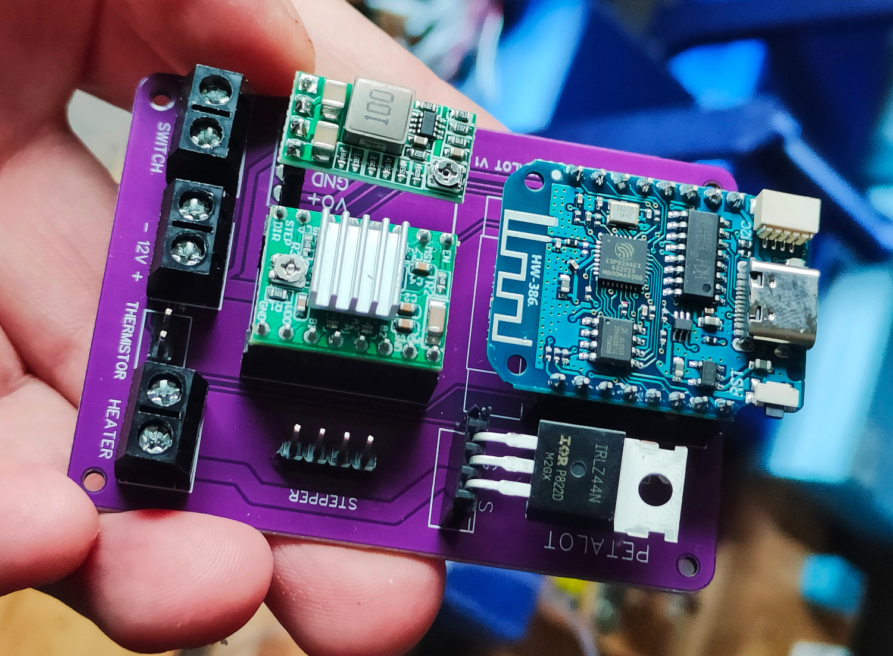
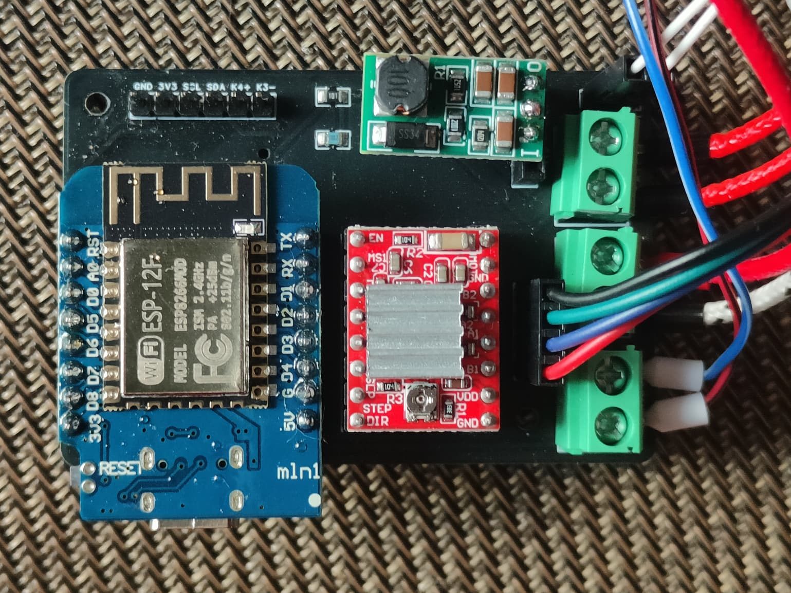
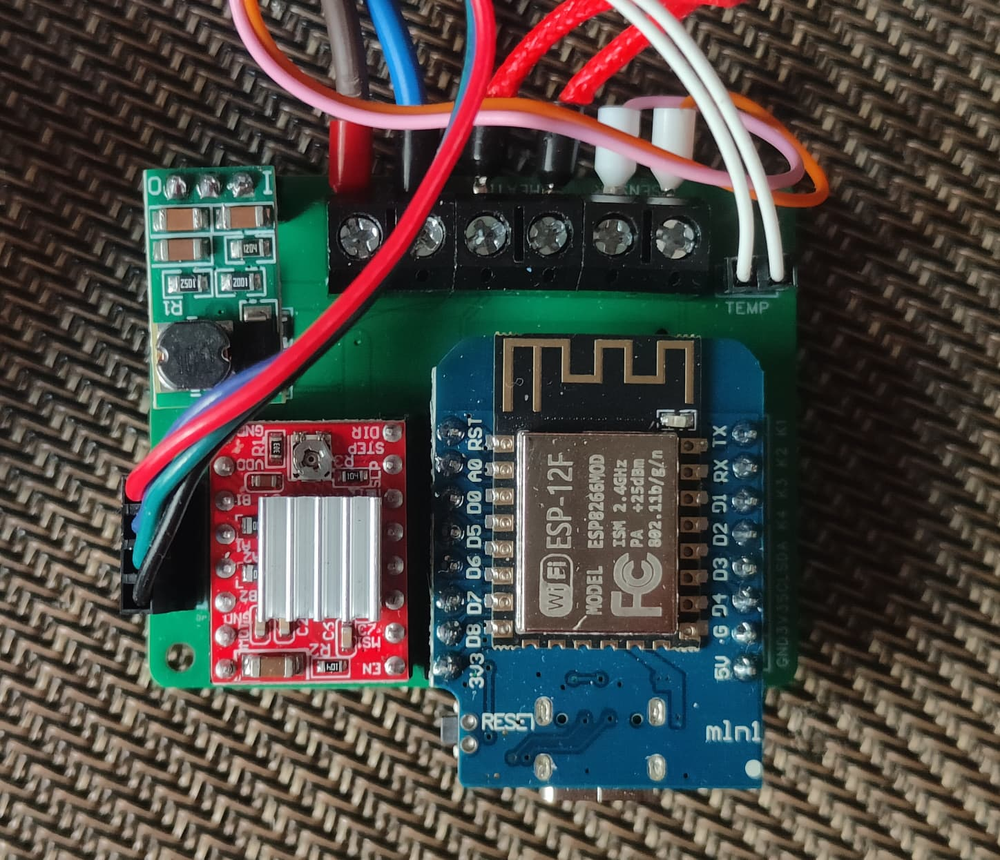

# PETALOT Firmware

There is **one firmware**, built separately for each hardware revision. The
four builds share the same web UI; they differ in the microcontroller pin
mapping (defined in `pins.hpp`) and in the default gear ratio (1:46 on older
boards, 1:50 on v1.5.3). Pick the `.bin` that matches the hardware you have
installed.

## Which firmware do I need?

| PCB version | Firmware file | Availability |
| --- | --- | --- |
| **v1.4.5** | [`petalot.1.4.5-v1.6.8.bin`](petalot/build/esp8266.esp8266.d1_mini_clone/petalot.1.4.5-v1.6.8.bin) | **DIY** — the only board released publicly. |
| **v1.5.1** | [`petalot.1.5.1-v1.6.8.bin`](petalot/build/esp8266.esp8266.d1_mini_clone/petalot.1.5.1-v1.6.8.bin) | **Commercial**. |
| **v1.5.2** | [`petalot.1.5.2-v1.6.8.bin`](petalot/build/esp8266.esp8266.d1_mini_clone/petalot.1.5.2-v1.6.8.bin) | **Commercial**. |
| **v1.5.3** | [`petalot.1.5.3-v1.6.8.bin`](petalot/build/esp8266.esp8266.d1_mini_clone/petalot.1.5.3-v1.6.8.bin) | **Commercial** (current, 1:50 gearbox). |

- If you built your own PETALOT from the public files, your PCB is the **v1.4.5**.
- Versions **v1.5.1**, **v1.5.2** and **v1.5.3** are only fitted on commercially
  sold machines.
- **v1.5.3** uses the same PCB and pin mapping as **v1.5.2**; only the gearbox
  ratio changes. Both values remain adjustable in Settings for retrofits.

> Do not flash a firmware that does not match your hardware revision.

## Identify your PCB

| v1.4.5 (DIY) | v1.5.1 | v1.5.2 |
| --- | --- | --- |
|  |  |  |

**v1.5.3** uses the same PCB as **v1.5.2**; it is identified by the 1:50
gearbox, not by a different board.

## Gear ratio calibration

The extruder speed depends on two mechanical values, both editable in
**Settings → General**:

- **Gear ratio**: motor revolutions per output revolution. `46` on v1.4.5,
  v1.5.1 and v1.5.2; `50` on v1.5.3.
- **Filament per output turn**: centimetres pushed by one output revolution.
  `29` on the standard drive pulley.

The firmware picks the default from the hardware revision, so a matching
`.bin` works out of the box. Change these values only when you retrofit a
different gearbox or drive pulley. A wrong ratio changes the real extrusion
speed and the filament statistics, because the machine has no closed-loop
speed sensor.

A factory reset keeps the current gear ratio and filament-per-turn values,
together with the PID tuning.

## First-time flash

1. Connect the Wemos to your PC.
2. Go to https://web.esphome.io/
3. Click **Connect**, select **USB Serial** port and **Connect**.
4. Click **Install**, then **Choose File**, select the `.bin` for your PCB and click **Install**.
5. Connect your phone to the Wi-Fi "PETALOT-XXXXXX" and browse to 192.168.4.1.
6. (Optional) Enter your local Wi-Fi SSID, password, IP address and subnet.

## Updating an existing device

You do not need a cable: update over the air.

### Online update (one-click, needs Internet while you do it)

Open the web UI and go to **Settings → Advanced → Online update**, then click
**Check for updates**. If a newer firmware for your PCB is available, click
**Install update** and it updates by itself.

This works when the device is connected to your home Wi-Fi: your computer or
phone is then on the same network, so it has Internet access and can fetch and
send the update. **It does not work while you are connected directly to the
device's own Wi-Fi hotspot** ("PETALOT-XXXXXX"): while connected to that, your
computer or phone has no Internet, so it cannot check or download anything. In
that case use the manual update below — it works with no Internet at all.

### Manual update (works offline, no Internet needed)

Use this if the device is not on your home Wi-Fi (for example, right out of the
box, when you connect directly to its "PETALOT-XXXXXX" network).

1. Download the `.bin` for your hardware from this repository
   (`petalot.1.4.5-v1.6.8.bin`, `petalot.1.5.1-v1.6.8.bin`,
   `petalot.1.5.2-v1.6.8.bin` or `petalot.1.5.3-v1.6.8.bin`).
2. Open the web UI and go to **Settings → Advanced → Firmware Update**, pick the
   file and click **Update**. (Or browse to `http://<device-ip>/update` — the
   built-in update page available on **every** firmware version.)

## Building from source

1. Open `Firmware/petalot/petalot.ino` in the Arduino IDE.
2. Set `PCB` to the hardware you are compiling for:

   | `PCB` | Hardware |
   | --- | --- |
   | `1405` | v1.4.5 |
   | `1501` | v1.5.1 |
   | `1502` | v1.5.2 |
   | `1503` | v1.5.3 (1:50 gearbox) |

3. Set `VERSION` to the firmware version you are publishing (e.g. `1600`).
   `VERSION` is independent of the PCB revision and is what the online update
   compares against `latest.json`.
4. Select **Tools > Board > esp8266 > LOLIN(WEMOS) D1 mini (clone)**.
5. Compile and upload.

The pin mapping for every hardware revision lives in `Firmware/petalot/pins.hpp`.
The gearbox defaults live in `Firmware/petalot/conf.hpp`.
See [`INSTALL_LIBRARIES.md`](petalot/INSTALL_LIBRARIES.md) for the
required libraries and board setup.

### Previewing the web UI without flashing

[`tools/webui_preview.py`](tools/webui_preview.py) serves `web_ui.h` in your
browser (mock data, or proxied to a real device) so you can edit the UI and
press F5 — no build or flash. See [`tools/README.md`](tools/README.md).

### Publishing an online update

1. Build the four firmwares (one per `PCB`) with the new `VERSION`.
2. Regenerate the manifest:

   ```
   python3 Firmware/tools/gen_latest_json.py <VERSION>
   ```

   This writes `latest.json` next to the `.bin` files, with the version, file
   name and size for every PCB.
3. Commit and push the four `.bin` files and `latest.json` to the repository
   (the online update reads them from `master`).
